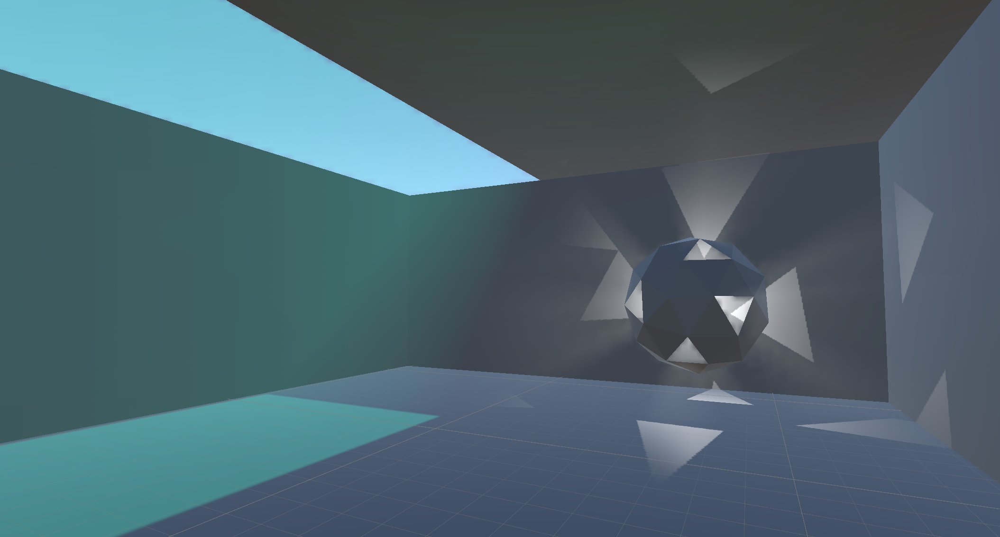

# Unity Volumetric URP

Compact volumetric lighting system for the Universal Render Pipeline.

Designed to add visible light beams, atmospheric depth, and shadowed volumetric response in URP scenes.

## Features

- Main directional light volumetrics
- Additional point and spot light volumetrics
- Shadowed light scattering
- Per-light opt-in control through `Runtime/VolumetricLight.cs`
- Independent toggles for direct lighting and additional lights
- Debug views and optional Kawase blur

## Setup

1. Add `VolumetricLightingRendererFeature` to your URP renderer.
2. Configure the renderer feature settings in the inspector.
3. Add `VolumetricLight` to every `Light` that should affect volumetrics.
4. For the sun or other primary directional light, keep `enableDirectLighting` enabled.
5. For point and spot lights, enable `enableAdditionalLights`.

Lights without `VolumetricLight` are ignored by the volumetric pass.

## Renderer Feature Settings

`VolumetricLightingRendererFeature.Settings` includes:

- `gridX`, `gridY`, `gridZ` for froxel resolution
- `nearOffset` and `maxDistance` for volume depth range
- `scatteringStrength`, `stepCount`, and `jitterStrength` for sampling quality
- `compositeDepthBias` for compositing control
- `enableDirectLighting` to allow or disable main directional light scattering
- `enableAdditionalLights` to allow or disable point and spot light scattering
- `enableKawaseBlur` and `kawaseIteration` for post blur
- `debugMode` and `debugOpacity` for visualization
- `renderPassEvent` for integration timing

## Per-Light Control

Attach `VolumetricLight` to any light you want processed by the volumetric system.

- `processVolumetricLighting = true` includes the light
- `processVolumetricLighting = false` excludes the light
- disabling the component also excludes the light
